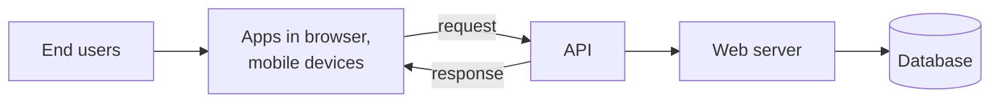
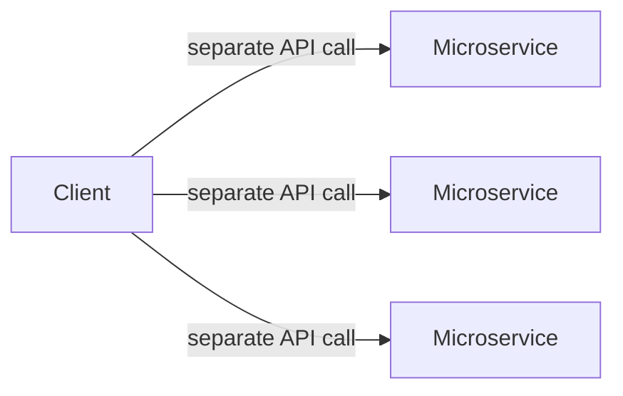
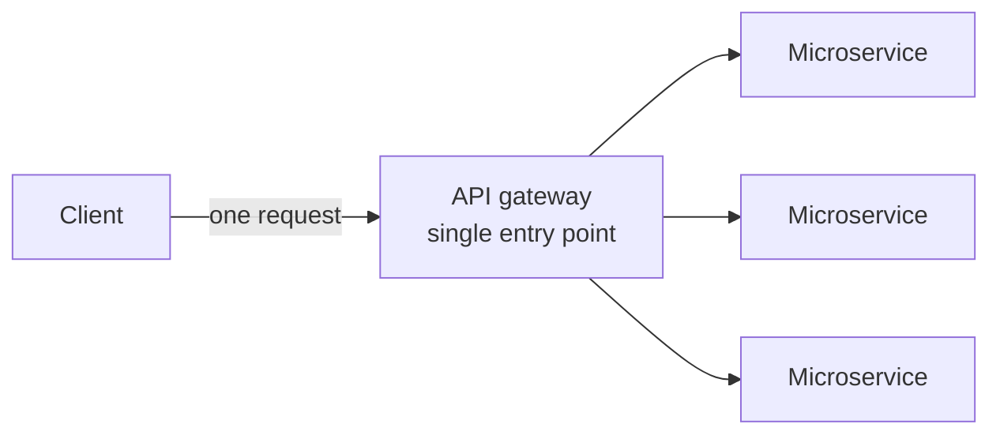

# Introduction To API

- service of network APIs were availale for developers to consume using remote procedure calls(RPCs).

## Benefits of APIs
- complexity abstraction: the caller only focus on the interface and return data from callee
- improved modularity: breaking down application to subsets of service which is more flexible and reusable
- efficient development: can request different service by changing the params without the need to rewrite code from scratch
- controlled accessibility: flexibility to share limited data of information with a restricted number of users

## Types of APIs

| Type | Example | Authentication Type |
| ---- | ------- | ------------------- |
| Public API | GoogleMaps, Weather APIs | Publicly accessible with API keys |
| Private API | Educative APIs for creating course | No authentication |
| Partner API | Amazon APIs for partners | authorized access with token/license |
| Composite API | Payment APIs | Depends on the API authentication |

## API Gateway 

- typical approach with multiple microservices at a time, would be make separate API call for each microservice, which is resource consumption
- api gateway help to create single entry point for all API request 
- provides security, authentication, and rate limiting to protect APIs from overuse
- provide stabilization to the system by balancing the network traffic

**Without a gateway** — a separate API call per microservice:

**With a gateway** — one entry point for all API requests:

## Monolithic Architecture VS Microservice Architecture

| Type | Advantages | Disadvantages |
| ---- | ---------- | ------------- |
| Monolithic | easy develop and deploy, simple to test because all are coupled together, low initial cost of system | hard to scale because all coupled, need to deploy the entire application, problem with reliability |
| Microservice | easy to manage due to decoupled services, easy development and deployment as each is updated individually, realiable as a single service cant bring down the whole application | costly in terms of services, development, and networking, more complex to manage fue to distributes attributes, security issues as communication between services can make data vulnerable |

