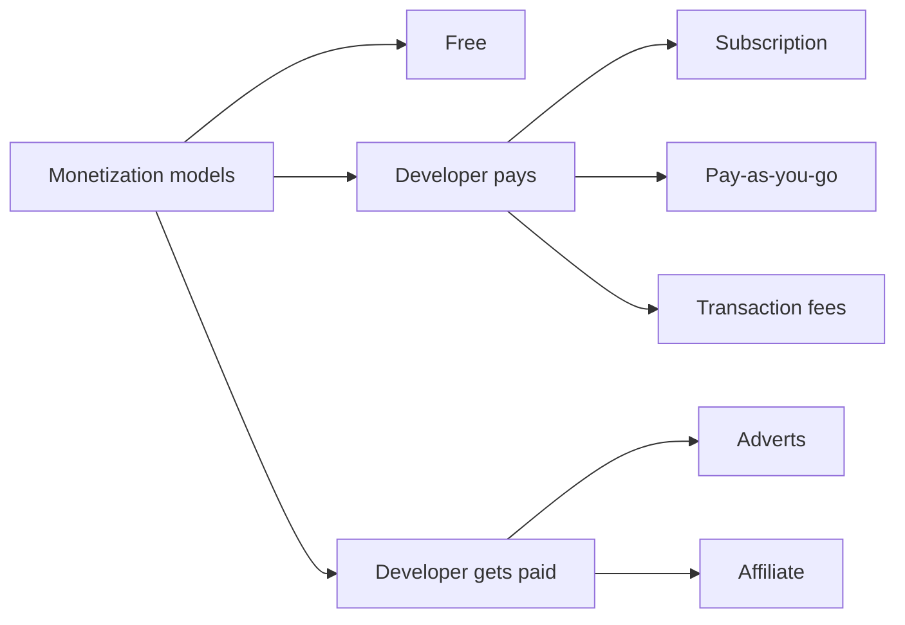

# Business Considerations with api

## The role of API in modern business strategy
- monetizing existing assets: an example would be IBM selling access to Watson for data analytics
- connecting business domains: an example of this is google suite which contains different products that cater to different domains such as Gmail and Google Drive
- self-service
- innovation: an example would be Uber using Google Maps API creating ride-sharing apps
- automation

## API monetization models

## Performance Measures
- tools that with metrics that drive business decisions: SLIs, SLOs, SLAs

### SLIs(service level indicators)

| Indicator | Definition |
| --------- | ---------- |
| request latency | how long it takes to return a response to request |
| error rate | the number of failed requests divided by number of total request |
| system throughput | the amount of work that system can handle over a given period |
| availability | the fraction of a time when the service is usable |
| durability | the likelihood that data will be retained over time |

### SLOs(service level objectives)
A good SLO should specify how it will be measured and what valid conditions it has. Let's understand this with a few examples:

- Response time of 95% of API calls < 500 ms
- The availability of the API is ≈ 98%

### SLAs(service level agreements)
- defines the metrics and methids for measuring the service, such as uptime, response time, errors and etc
- establishes the consequences if the service fails to meet the agreed-upon objectives
