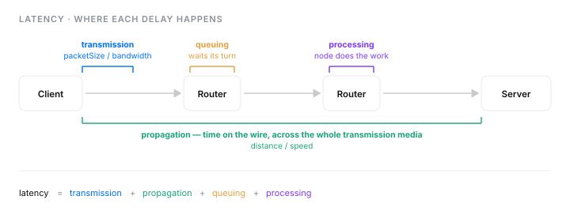
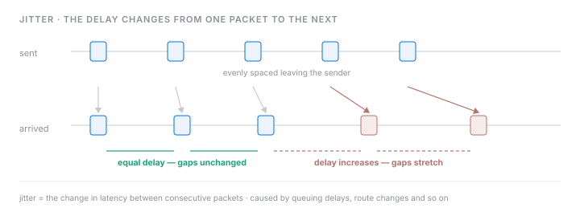
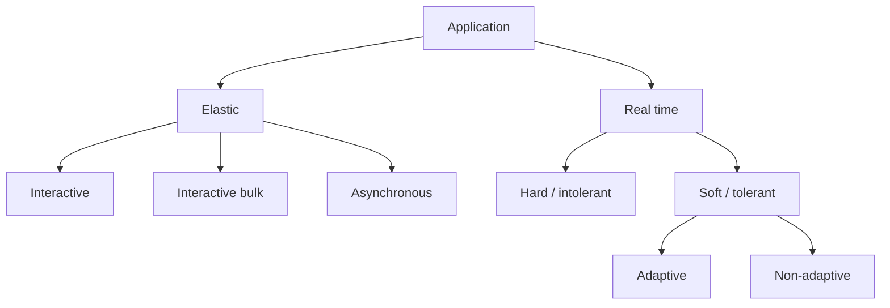

# Latency and throughput
Knowing what constitutes the latency and throughput enhances our understanding how to write better API services level agreements and some possible way to reduce latency. 

## Throughput
- refers to the data rate that passes through many network hops. if we have a 1Mbps effective throughput we cant sent more than 1Mb of data in a second.

## Latency
- refers to a user-level message takes to travel from the sender to the receiver. we often more concerned about the user-perceived delay, which is a function of the round trip time(RTT).
- latency = transmission delay + propagation delay + queuing delay + switch/node processing delay



### Transmission Delay

- transmission delay = packetSize / bandwidth
- size of packet and transmission media capacity affect the transmission delay, sending the compressed data over the network helps to reduce data size

### Propagation delay

- propagation delay = distance / speed

### Queuing delay

- refer to the time needed for a node to hold the packet before it can be proceed. 
- queuing delays depends on multiple factors, such as: the time interval between the packets, transmission capacity of the outgoing link, current congestion conditions at the routes

### Processing delay

- refer the time the node(routers) and end hosts(server) take to process the packet (depends on the processing speed of the nodes and end host)

## Jitter



- refer to the latency changes from one packet to the next (网路抖动), such as queuing delays, changes in the route and so on.

```
ping -c 5 educative.io
```

| Packet | Time (t₁) | Time (t₂) | Delay difference \|t₁−t₂\| |
| ------ | --------- | --------- | -------------------------- |
| 1 and 2 | 11.0 ms | 10.3 ms | 0.7 ms |
| 2 and 3 | 10.3 ms | 10.3 ms | 0 ms |
| 3 and 4 | 10.3 ms | 10.3 ms | 0 ms |
| 4 and 5 | 10.3 ms | 10.2 ms | 0.1 ms |

The jitter is the mean of the delay differences: (0.7 + 0 + 0 + 0.1) / 4 = **0.2 ms**


## Latency-bandwidth product and network utilization
- sending one packet and then waiting for a response is wasteful, we can determine how many packets a link can hold by using latency-bandwidth product.
- formula: latency * bandwidth

For example, if the effective bandwidth measured on the client-side is 1 Mbps, and the client-to-service user-perceived time is 200 ms, then how many bits will be in transit?

latency * bandwidth = 200 * 1000 bits = 200 kbits


## Application classes
- application can be divide into different classes on the basis of delay, such as elastic and real time applications. Elastic applications can tolerate the delay and real-time application cannot tolerate substantial delay.




### Type of elastic applications

| Types | Description |
| ----- | ----------- |
| Interactive | Any application that allows us to input data and get a response. For example, Telnet. |
| Interactive bulk | Any application that allows us to input data and get a large amount of responses. For example, File Transfer Protocol (FTP). |
| Asynchronous | Any application that does not wait for the response to give the next instruction. For example, email. |

### Type of real-time applications

| Types | Description |
| ----- | ----------- |
| Hard/intolerant | This doesn’t allow any tolerance for delay, for example, live video conferencing. |
| Soft/tolerant | This allows a little tolerance for delay, for example, web browsing. |
| Adaptive | Some applications adjust their functionality according to the network conditions and are considered adaptive. For example, the playback point of a live streaming event. The playback point tells us how long the buffer keeps the packet before it’s played back. If packets arrive within 200 ms, then we can set the playback point to 200 ms. But if packets are suffering from some delay due to network conditions, then the application can adjust the playback point to the possible delay, and it’s referred to as “delay adaptive.” |
| Non-adaptive |  Some applications don’t adjust their functionality according to the network conditions. For example, if the playback time is 300 ms and suddenly packets are arriving within 100 ms, the packets still wait for 300 ms before it’s played back. |