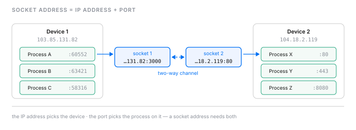
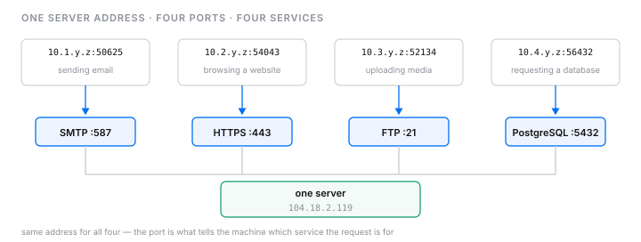
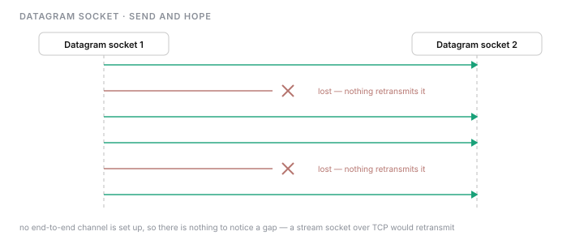
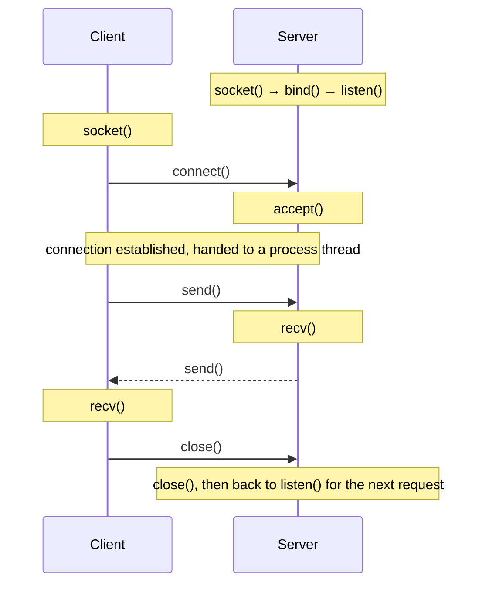

# Network sockets as a foundation for communication

- popular api technologies such as RESTful, GraphQL, and GRPC work differently but at the most basic level, they all use socket interfaces for process identification, connection establishment, and interprocess communication.

## What is socket?

- socket is an interface that creates a two way channel between processes communicating on different devices. processes running on the application layer use sockets as an interface to take services from transport layer to establish communication. The interface (IP address + port) is referred ti as a socket address.



- port numbers ranging between 1-1024 are well-known ports because they mostly used as a standard for particular service. port 80 and 443 are used for HTTP and HTTPS. the transport protocol (TCP or UDP) specified in the transport layer responsible for exchanging data between these processes. 

## Multiple concurrent connections

- multiple processes/services running on one machine and communicating with different processes running on different machine that connected via a network 




## Categories of network sockets

### Stream sockets

- creates reliable end-to-end connection between the two endpoints using transport protocols like TCP and SCTP to transmit data between processes. It also utilize the recovery facility of the protocol like TCP to retransmit the lost data during data propagation phase.

- stream socket created on TCP can be in different states with different flags

| type | desc |
| ---- | ---- |
| SYN | synchronization flag, the number in front of SYN is the sequence number of the packet being sent  |
| ACK | acknowledgement flag, the number in front of ACK is the sequence number indicating the last successfully received byte by the remote peer |
| FIN | finish flag, the number in front of ACK is the sequence number indicating the last successfully received byte by the remote peer |

### Datagram sockets

- dont create an end-to-end channel between two endpoints to transfer data between processes. It just sends data and expects it to reach the receiver end.




## The role of sockets in API development



| Function | Description |
| -------- | ----------- |
| socket | creates a file descriptor for an endpoint of a connection, representing the socket address family, socket type, transport protocol, and so on |
| bind | associate a buffer with socket descriptor and gives a unique local name |
| listen | changes the mode to only accept new connections and associates a connection queue to keep track of pending connections |
| connect | creates an active connection when using a stream socket and specifies the peer when using a datagram or raw socket |
| accept | connects to a pending request by defining a new socket descriptor with the same set of associated properties |
| send | writes data from the buffer to a socket and transmits it to the other end of a connection |
| recv | reads data from the socket and stores it in a buffer transmitted by the other end of a connection |
| close | closes the connection and frees the resources associated with the socket descriptor |


### Example of a running application

- proto: shows the type of protocol used for network transport
- local address: shows the address of the source socket 
- foregin address: shows the address of the destination socket
- state: shows the state of the connection

```
Active Internet connections (servers and established)
Proto Recv-Q Send-Q Local Address       Foreign Address     State        PID/Program name
tcp        0      0 127.0.0.1:27017     0.0.0.0:*           LISTEN       35/mongod
tcp        0      0 0.0.0.0:8080        0.0.0.0:*           LISTEN       106/node
tcp        0      0 0.0.0.0:8890        0.0.0.0:*           LISTEN       7/./server
tcp        0      0 172.17.0.2:8080     10.128.0.5:37110    ESTABLISHED  106/node
tcp        0      0 127.0.0.1:27017     127.0.0.1:59620     ESTABLISHED  35/mongod
tcp        0      0 172.17.0.2:40606    10.128.0.91:8888    TIME_WAIT    -
tcp        0      0 172.17.0.2:40616    10.128.0.91:8888    TIME_WAIT    -
tcp        0      0 172.17.0.2:8890     10.128.0.56:38750   TIME_WAIT    -
tcp        0      0 127.0.0.1:59620     127.0.0.1:27017     ESTABLISHED  38/node
tcp        0      0 172.17.0.2:8890     10.128.0.5:50498    ESTABLISHED  7/./server
tcp        0      0 172.17.0.2:40610    10.128.0.91:8888    TIME_WAIT    -
tcp        0      0 172.17.0.2:8890     10.128.0.56:38800   TIME_WAIT    -
tcp        0      0 172.17.0.2:8890     10.128.0.5:50512    ESTABLISHED  7/./server
tcp        0      0 172.17.0.2:40614    10.128.0.91:8888    TIME_WAIT    -
tcp6       0      0 :::3000             :::*                LISTEN       38/node
```

- we see that some rows have the IP address, 0.0.0.0 which means that the socket is open for connections through all the device network interfaces

| status | description |
| ------ | ----------- |
| LISTEN | indicates server sockets passively listening for incoming connection requests |
| ESTABLISHED | represent the connection between the vue, database and the node js server |
| TIME_WAIT | show that the connection is closed from the local socket and is waiting for the remote socket to finish sending data |

