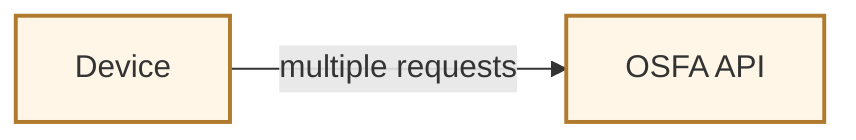
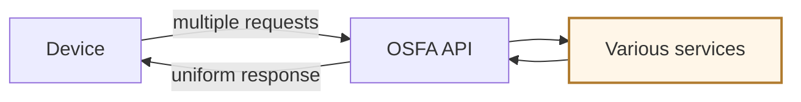
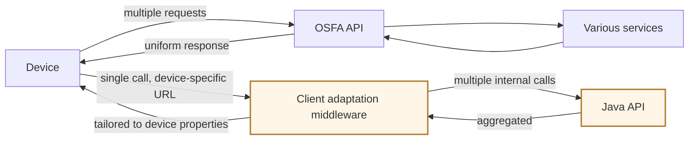

# Important concepts in product architecture

- API versioning
- evolution strategies
- rate limiting
- client-adaptive response

## Versioning principles

A version should:

- stay **backward compatible**
- be updated at a **low frequency**
- **not break client applications**

## When do we need versioning?

We need a new version when:

- the structure of the output is altered — for example, from a string to JSON
- entities are renamed — `userId` becomes `userCredentials`
- an API is broken into microservices

## Versioning approaches

Three approaches are popular, and they differ in where the version is carried:

| Approach | Where the version lives |
| -------- | ----------------------- |
| URL versioning | in the path — `/v1`, `/v2` |
| HTTP header versioning | negotiated through the HTTP `Accept` header |
| Hostname versioning | each version gets its own hostname |

## Evolving an API design

Three ways:

- Twitter moved from clients constantly polling the Twitter API for new tweets, to a streaming API that uses persistent connections and lets developers subscribe to keywords
- provide options to filter results, such as date, order, and options to return specific fields (Slack RTM API)
- support bulk endpoints — Slack, for instance, lets you invite multiple users in one call

## Rate limiting

Rate limiting enforces a cap on the number of requests, or the data volume, that a client can consume per unit of time. Rather than disconnecting clients, the rate limiter throttles excess requests by discarding them. It is considered a security layer against bots and DoS attacks.

Four strategies:

| Strategy | What it does |
| -------- | ------------ |
| Consumption quota | defines the maximum number of API calls a client can make within a time frame |
| Spike arrest | detects and blocks an unexpected surge |
| Usage throttling | slows excessive calls from a specific user |
| Traffic prioritization | gives different quotas to different tiers — premium and free users, for example |

### How a rate limiter works

When a request comes in, the rate limiter looks up the client information, checks it against the maximum, then adds to the count.

### Where to place a rate limiter

| Placement | Consequence |
| --------- | ----------- |
| On the client | it is vulnerable |
| On the server | the same server handles both the API logic and the rate limiting |
| In middleware | it is isolated from the frontend and the backend, which keeps rate-limiting concerns decoupled |

### Characteristics of rate limiting

- return an **appropriate HTTP status code** — `429` when a request is throttled, together with a `Retry-After` header
- send **custom response headers** — `X-RateLimit-Limit`, `X-RateLimit-Reset`
- expose a **rate-limit status API** — a way for the client to query the limit status of a certain API

### Rate-limiting best practices

- choose among **different algorithms** — token bucket, leaky bucket, fixed window, sliding window
- **threshold selection** — 〔原文未说明: 按什么标准选阈值〕
- **exponential backoff** — progressively increase the wait time between retries

## Server-side flexibility

- **intermediate adaptation code (IAC)** — the Netflix example, walked through below
- **expanded fields** — `/finder/location` provides only the location details, but `/finder/location?expand=images` also provides the images inside those details
- **GraphQL** — a single request fetches diverse 〔原文未说明: diverse what〕 in one round trip

### The Netflix example, step by step

**① A device opens the Netflix main page, which triggers multiple requests to the OSFA API.**

**② The OSFA API retrieves data from various services, formats it, and delivers one uniform response — the same shape for every device.**

**③ With IAC, a client adaptation middleware takes one call to a device-specific URL, determines the client type, expands it into multiple internal calls to the Java API, aggregates the responses, and tailors the output to the device's properties before returning it.**

---

## What changed

**Fragments completed into sentences** — this is the bulk of the edit. Bullets that were noun phrases now have a subject and a verb, using the original's own words: the three versioning principles (`backward compatible` → `stay backward compatible`, under a `A version should:` stem), the three versioning triggers (now clauses under `We need a new version when:`), all three rate-limiter placements (`client: vulnerable` → `it is vulnerable`), and the three characteristics of rate limiting (each now starts with a verb — return / send / expose).

**Typos / terminology** — `form` → `from` · `diconnecting` → `disconnecting` · `calles` → `calls` · `priorization` → `prioritization` · `approtate` → `appropriate` · `rete-limit` → `rate-limit` · `srtatus` → `status` · `limitting` / `limittinga` → `limiting` · `progressivel` → `progressively` · `flexbility` → `flexibility` · `exmaple` → `example` · `graphQL` → `GraphQL` · `usercredentials` → `userCredentials` (matched to `userId` on the same line) · `SLACK` → `Slack`

**Structure** — three sets of parallel one-line definitions (versioning approaches, rate-limiting strategies, placements) became tables, matching how the earlier notes in this repo present comparisons. The wording inside them is unchanged.

**Reference cleared up** — "this provide the images" → "it also provides the images", where *it* is the `?expand=images` call.

**Completed from context — please check** — "server: same server handles both api logic" named only one of the two things `both` promises; written as "both the API logic and the rate limiting". Reject it if that is not what you meant.

**Not completed** — three gaps left marked rather than guessed: 〔原文未说明〕 what `threshold selection` selects a threshold *by*; 〔原文未说明〕 what GraphQL "fetches diverse" — the object is missing; 〔原文未说明〕 how IAC *determines the client type*, which the summary states but does not explain.

**No category name was invented** — the first evolution bullet is left as the raw Twitter example, because the summary gives the example without naming the category it belongs to.

**Diagrams** — 1 storyboard, 3 panels (the Netflix IAC example). It qualifies on two counts: hierarchy (a middleware sits between the device and the Java API) and concurrency (one call fans out into multiple internal calls, then aggregates). Three panels because the summary supplies exactly three slides. Panel ③ keeps the OSFA path visible, so the contrast between the two architectures is what changes between panels.

Nothing else was drawn. The versioning approaches, rate-limiting strategies, placements, characteristics and best practices are one-line definitions or comparisons — a table carries them. "How a rate limiter works" is a sequence, but the summary gives it in one sentence, and a four-node flowchart would only restate that sentence.
