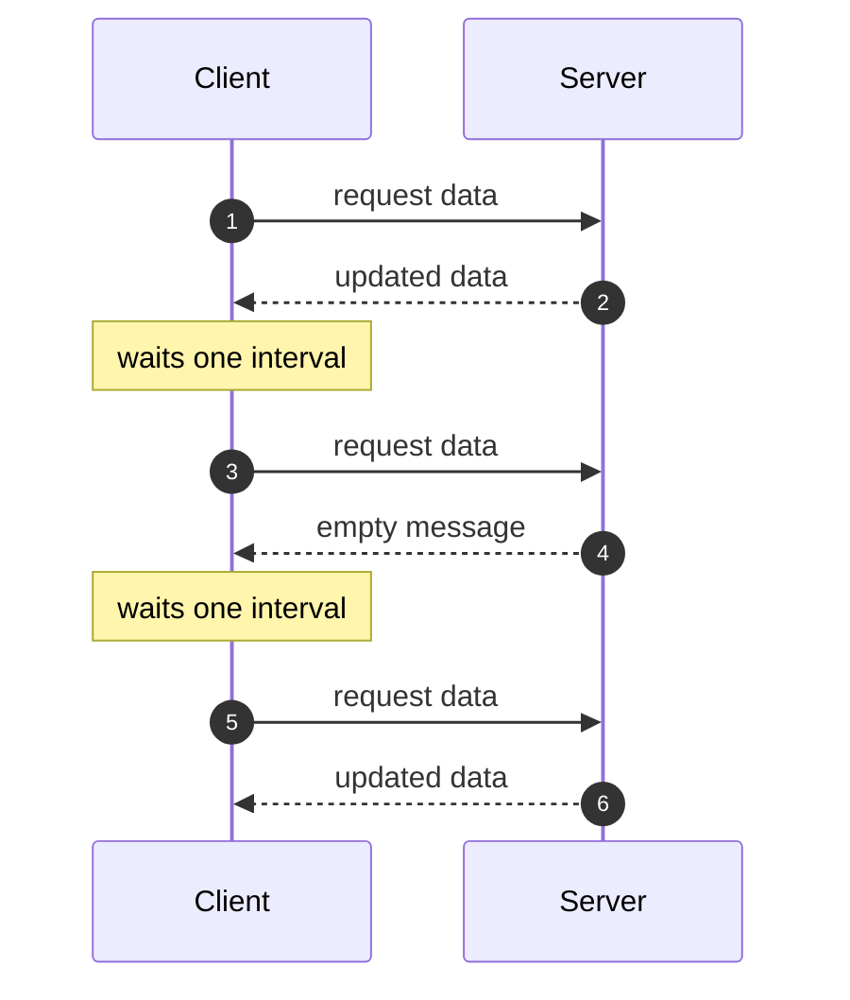
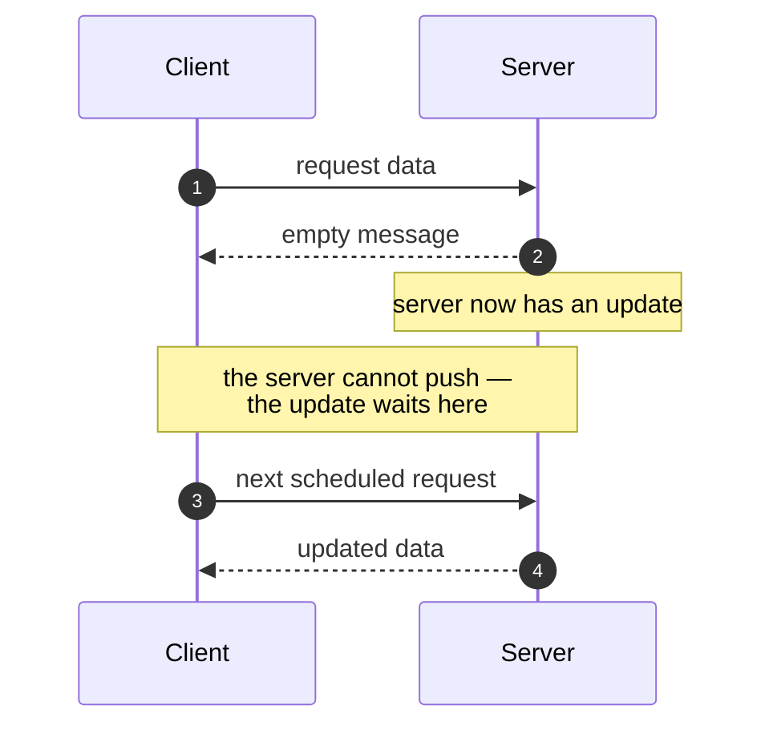
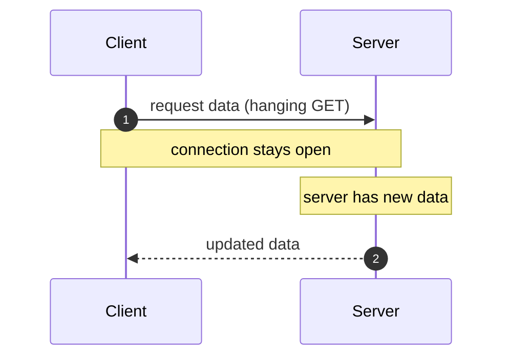

# Data-fetching patterns

Data can be fetched by **short polling**, **long polling**, and **WebSockets**.

There are also **event-driven protocols**: webhooks, SSE, and WebSub.

> 〔原文未说明〕 WebSockets, webhooks, SSE and WebSub are named but not described in this
> summary. Only short polling and long polling are covered below.

## Short polling

The client requests data at regular intervals, and the server responds either with the updated data or with an empty message.

### The delay problem

When the server has no update, the response is empty. And the server cannot push an update until the client's next scheduled request arrives — so an update that lands just after a poll has to wait out the rest of the interval.

## Long polling

Long polling, also called a **hanging GET**, keeps the connection open until the server has new data.

### Problems with long polling

- there are delays while waiting for updates, or while waiting for timeouts
- the server must manage unresolved state for many connections, and the timeout details that go with them
- the client needs multiple concurrent connections, so that it can send new information while an existing connection is still awaiting a response or timing out

---

## What changed

**补成句 — 原文 8 个残句 / 补了 8 个，0 个故意保留。** 另有 2 句结构本来就完整、只是拼写损坏，只做了修复。

| 原文 | 补成句 |
| ---- | ------ |
| `data-fetching such as short pollng, long polling, websiockets` | `Data can be fetched by short polling, long polling, and WebSockets.` |
| `event-driven protocols like webhooks, sse, websub` | `There are also event-driven protocols: webhooks, SSE, and WebSub.` |
| `short polling : request data at regular intervals,serer responds with...` | `The client requests data at regular intervals, and the server responds either with...` |
| `problem for this is when server no update , is empty response` | `When the server has no update, the response is empty.` |
| `;the server canot push an update until the clinet next scheduled arrives` | `the server cannot push an update until the client's next scheduled request arrives` |
| `long polling also called hanging get keeping te connection open until...` | `Long polling, also called a hanging GET, keeps the connection open until...` |
| `problem with lomng polling is that` | 变成小节标题 `Problems with long polling` |
| `delays while waiting for updates or timeouts` | `there are delays while waiting for updates, or while waiting for timeouts` |

**只修拼写、结构未动的 2 句** — `the server must manage unresilved state for many connection and timeout details` · `client need multipkle concurrent connectinos to sent...`

**错字 / 术语** — `pollng` → `polling` · `websiockets` → `WebSockets` · `sse` → `SSE` · `websub` → `WebSub` · `serer` → `server` · `canot` → `cannot` · `clinet` → `client` · `te` → `the` · `hanging get` → `hanging GET` · `lomng` → `long` · `unresilved` → `unresolved` · `multipkle` → `multiple` · `connectinos` → `connections` · `respose` → `response` · `ot time oiut` → `or timing out` · `many connection` → `many connections` · `client need` → `the client needs`

**补全 — 请核对（3 处，都是我的推断）**
1. `the clinet next scheduled arrives` 缺名词，补成 `the client's next scheduled **request** arrives`（`request` 一词取自上一句「request data at regular intervals」）
2. `to sent ne windomation` 里的 `ne windomation` 严重损坏，解读为 `new information`。**这是猜的**，不对请改
3. 延迟问题那段我加了半句 `so an update that lands just after a poll has to wait out the rest of the interval` —— 这是把原文两句的因果讲出来，没有引入新机制，但它是原文没写的话，可以删

**未补的** — 〔原文未说明〕 WebSockets、webhooks、SSE、WebSub 四项只在开头被列出，摘要里没有任何说明，正文因此只保留列名并在开头标注。没有替它们补定义。

**图 — 3 张，都是你点名要的。** 三张都满足「顺序」判据（client 与 server 之间有先后，顺序错了结果就不对）。

用的是 `sequenceDiagram` 而不是多格分镜：时序图本身就是纵向时间轴，一张图里每条消息就是一次变化，再拆成分镜等于把同一根时间轴切断重画。skill 里「机制只有一个动作、或格与格之间没有状态变化时，一张图加编号标注就够」适用于此，`autonumber` 承担编号。

延迟问题那张的重点是那段死窗口，所以用 `Note over C,S` 把它标在两条生命线中间——它不是一次消息传递，是一段什么都没发生的时间。
