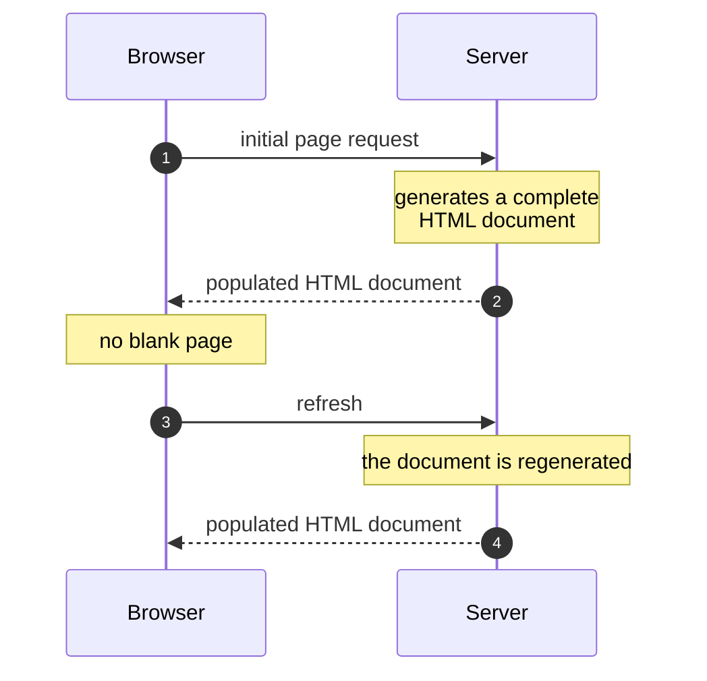

# Product architecture III

Two rendering approaches: **server-side rendering** and **client-side rendering**.

## Server-side rendering

SSR generates a complete HTML document on the server and sends it to the client.

**Pro** — loading is fast, and the user doesn't see a blank page, because the server sends the browser an HTML document that is already populated.

**Con** — when the webpage is refreshed, the document is regenerated to render the component and sent to the client again.

**When to use it** — when a fast initial page load is critical, and when SEO matters.

The same section as one figure — the path, what it buys, and what it costs on every refresh:

## Client-side rendering

CSR generates the web page in the browser. The server sends an empty HTML shell together with the JavaScript code, and the browser executes the script to build the page.

Frameworks like React and Vue handle the client-side content creation, which enables selective re-rendering of specific DOM elements without full page reloads.

**When to use it** — when content is updated frequently, when the page includes dynamic content that requires fast re-renders, and when SEO is not a priority.

**The hybrid approach** — nowadays a hybrid approach is preferred, using SPF (structured page fragments) for static and dynamic loading of page content.

---

## What changed

分两轮写的:第一轮只有 SSR,第二轮补了 CSR。**上一轮标记的缺口,这一轮被填上了。**

### 第二轮 · CSR(本次)

**补成句 — 原文 4 个残句 / 补了 4 个,0 个故意保留。**

| 原文 | 补成句 |
| ---- | ------ |
| `csr - generates the web page in browser, server sends an empty HTML shell...` | `CSR generates the web page in the browser. The server sends an empty HTML shell together with the JavaScript code, and the browser executes the script to build the page.`(拆成两句,原来是一长串分号连缀) |
| `* update content frequently` | `when content is updated frequently` |
| `* includes dynamic content requires fast re-renders` | `when the page includes dynamic content that requires fast re-renders` |
| `nowadays prefer hybrid approach, using SPF (structured page fragments)...` | `nowadays a hybrid approach is preferred, using SPF (structured page fragments)...` |

`SEO is not a priority` 本来就是完整句,只做了并列化。

**错字 / 术语** — `browser execute` → `browser executes` · `client site` → `client-side` · `react,vue` → `React, Vue`

**缺口关闭** — 上一轮的 `〔原文未说明〕 客户端渲染完全没有内容` 已删除,`023.svg` 里那个琥珀色缺口块也一并移除。**缺口标记的价值就在于它会被关掉**;留着一个已经填上的缺口比没有标记更糟。

**图 — 新增 2 张,都来自你给的截图,截图本身没有入库。**

- `024.svg` —— 六步管线(HTTP 请求 → 最小 HTML + JS 链接 → 解析 → DOM → JS 调 DOM API → DOM API 更新 DOM → 绘制)。判据是数据流:它经 DOM API 绕回 DOM,这个回路是散文里那句「browser execute the script to build the page」展开后的样子。
- `025.svg` —— 静态 vs 动态加载。判据是**位置有含义**:哪一块区域重渲是这张图的全部内容,mermaid 的自动布局表达不了。它支撑的是你那句「selective re-rendering specific DOM elements without full page reloads」。

**注意:这两张图里的细节多于正文。** 六步的编号、DOM 的 HTML/Body/H1/Link/Script 结构、侧边栏与网格的划分,都来自截图而不是你写的文字。截图是你作为素材给的,所以我用了;但如果你希望正文和图严格同源,得把这些细节也写进正文。

### 第一轮 · SSR

**补成句 — 原文 5 个残句 / 补了 5 个,0 个故意保留。**

| 原文 | 补成句 |
| ---- | ------ |
| `* server-side rendering` `* client side rendering` | `Two rendering approaches: server-side rendering and client-side rendering.` |
| `ssr = generates a complete html document on the server and sends it to the client` | `SSR generates a complete HTML document on the server and sends it to the client.` |
| `pro = fast loading, user dont see blank page because...` | `loading is fast, and the user doesn't see a blank page, because...` |
| `cons = refresh webpage the document is regenarated to render component and sent to the client` | `when the webpage is refreshed, the document is regenerated to render the component and sent to the client again` |
| `when to used ? fast initial page load is critical, SEO matters` | `when a fast initial page load is critical, and when SEO matters` |

**错字 / 术语** — `docuemnt` → `document` · `regenarated` → `regenerated` · `dont` → `don't` · `client side` → `client-side` · `html` → `HTML` · `when to used ?` → `When to use it` · `pro`/`cons` → `Pro`/`Con`(单数,因为各只有一条)

**补全 — 请核对(2 处,都还在)**
1. con 那句结尾补了 `again`。原文没写「又一次」,但整句要点就是重复。
2. `023.svg` 前那句引语 "The same section as one figure…" 是我写的,不要可以删。

**图 — 2 张。** mermaid 时序图画时间轴(初次加载 vs 刷新);`023.svg` 画结构(刷新回到「建整份文档」那一步)。
