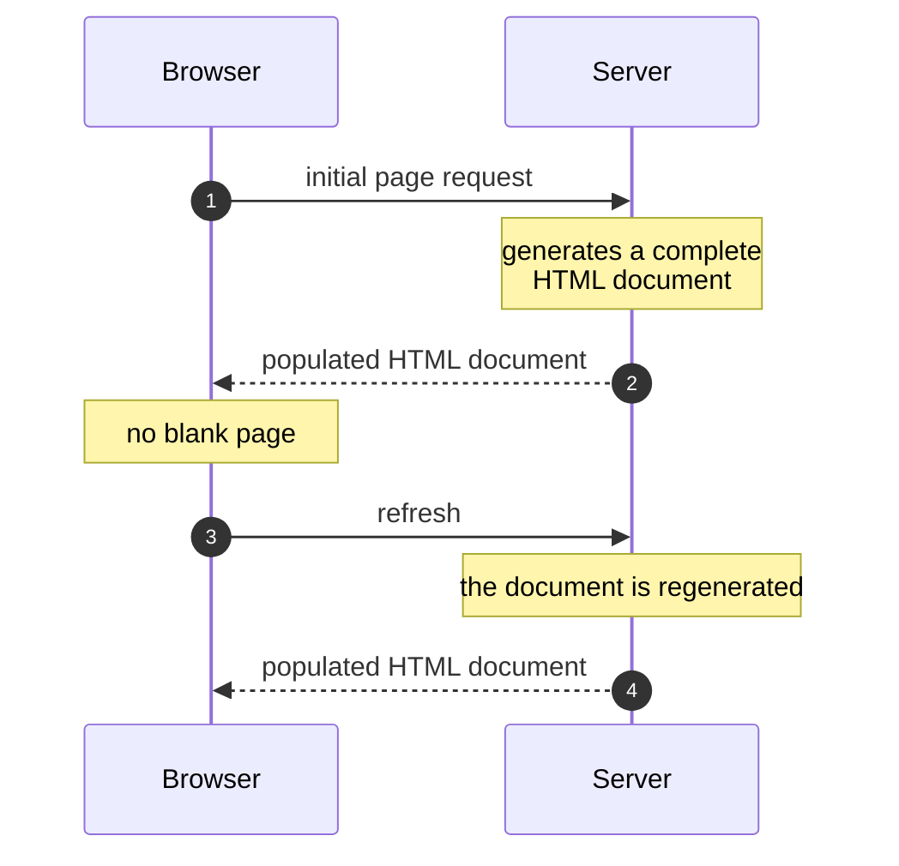
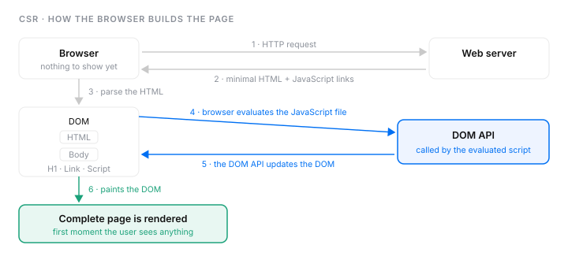
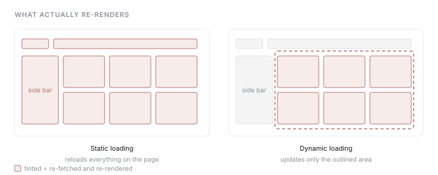
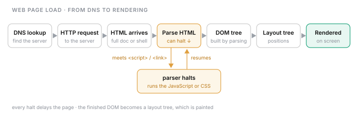
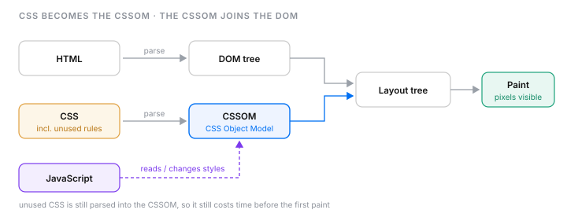
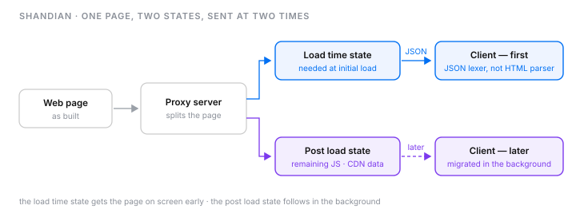
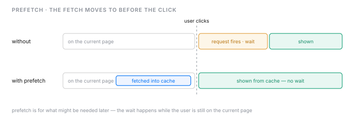
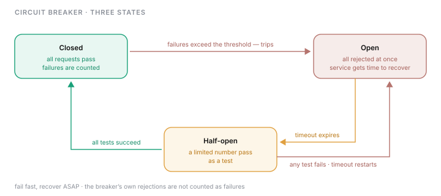

# Product architecture III

Two rendering approaches: **server-side rendering** and **client-side rendering**.

## Server-side rendering

SSR generates a complete HTML document on the server and sends it to the client.

**Pro** — loading is fast, and the user doesn't see a blank page, because the server sends the browser an HTML document that is already populated.

**Con** — when the webpage is refreshed, the document is regenerated to render the component and sent to the client again.

**When to use it** — when a fast initial page load is critical, and when SEO matters.

The same section as one figure — the path, what it buys, and what it costs on every refresh:

## Client-side rendering

CSR generates the web page in the browser. The server sends an empty HTML shell together with the JavaScript code, and the browser executes the script to build the page.

Frameworks like React and Vue handle the client-side content creation, which enables selective re-rendering of specific DOM elements without full page reloads.

**When to use it** — when content is updated frequently, when the page includes dynamic content that requires fast re-renders, and when SEO is not a priority.

**The hybrid approach** — nowadays a hybrid approach is preferred, using SPF (structured page fragments) for static and dynamic loading of page content.

## Speeding up web page loading

### Web page load process

The web page load process runs from DNS resolution to rendering:

1. the browser sends an HTTP request to the web server
2. the server constructs the HTML file and sends it back
3. the browser parses the HTML content — it halts parsing when it meets a `<script>` or `<link>` tag, to run that JavaScript or CSS code
4. parsing creates the DOM tree
5. the browser converts the DOM tree into a layout tree and renders it as the web page

### Inefficiencies in page load time

- **unused content** — CSS that is not used in the initial load is still parsed
- **round trips** — each URL costs a DNS resolution, a TCP connection setup handshake, and a request–response round trip (RTT)

The browser also parses CSS into the **CSSOM** (CSS Object Model), the style counterpart of the DOM. JavaScript reads and changes styles through it, and the browser combines it with the DOM before layout — which is why unused CSS still costs time.

### Minimizing PLT with Shandian

Shandian uses a proxy server to split the page into two states, and migrates the post load state to the page later, in the background.

- **load time state** — isolates the objects required at the initial load. The proxy server serializes this state into JSON and sends it to the client, which uses a modified JSON lexer instead of the HTML parser.
- **post load state** — contains the objects needed after the initial load, including the remaining JavaScript and unmodified CDN data.

### Other PLT optimization techniques

- JavaScript and CSS minification
- image size compression

## Resource hints and debouncing

### Resource hints

- **prefetch** — loads data that might be needed later and keeps it in the browser cache
- **preload** — forces the browser to download a resource because it is critical, but overusing it can mess with the browser's own prioritisation and scheduling
- **preconnect** — establishes a connection to a domain in advance, for example to a third-party API or Google Fonts

### Debouncing

Debouncing handles an event only after it has stopped firing for a set period. Every new event resets the timer, so a burst of events runs the handler once. It suits high-frequency events such as scrolling, key presses, and mouse movement — the same idea as a `debounce()` function in JavaScript.

## Circuit breaker pattern

A circuit breaker sits in front of a service and stops sending it requests while it is failing, so one slow or broken service cannot drag the others down with it. The rule of thumb: fail fast, recover ASAP.

### The three states

| State | What happens to requests | Moves on when |
| ----- | ------------------------ | ------------- |
| Closed | all pass through; failures are counted | failures exceed the threshold → **open** |
| Open | all rejected at once, without calling the service, which gets time to recover | the timeout expires → **half-open** |
| Half-open | a limited number pass through as a test | all succeed → **closed** · any one fails → **open**, and the timeout restarts |

- a request counts as **failed** when the service does not respond within its time limit; the breaker's own rejections do not count
- **example** — with a 300 ms limit, if 50% of requests to a service take longer, the breaker opens; after the timeout, half-open lets a fraction through (say 25 of 100 per second) to test it

### Why it prevents cascading failures

- without a breaker, callers of a slow service keep waiting on it and tie up their processes, until nothing is left for other services and the failure spreads
- with a breaker, callers get an immediate failure instead of waiting, so they can redirect or retry later, and the failure stays contained in one service

### Circuit breaker vs rate limiter

- a **rate limiter** caps how much traffic a client may send, whether or not the service is healthy (see note 06)
- a **circuit breaker** reacts to the service's health: it cuts traffic because the service is failing, not because a client sent too much

---

## What changed

分三轮写的:第一轮 SSR,第二轮 CSR,第三轮补齐课程后三节。

### 第三轮 · 页面加速 / resource hints / debouncing / circuit breaker(本次)

**来源** — 页面加速、resource hints、debouncing 三节是你写的摘要,润色而来。**Circuit breaker 整节是 Claude 代写的**:你说读了还不理解,让我整理。那一节不是你的理解,读完哪里不认同就改。

**补成句 — 原文 16 个残句 / 补了 14 个,2 个故意保留。** 另有 2 句结构完整(Shandian 的 load time state / post load state),只修拼写。

| 原文 | 补成句 |
| ---- | ------ |
| `web page load process from dns to rendering` | `The web page load process runs from DNS resolution to rendering:` |
| `1 send http request to webserver` | `the browser sends an HTTP request to the web server` |
| `2 construct sent the html file` | `the server constructs the HTML file and sends it back` |
| `3 browser parseing the html content (it halts parsing when encounter script or link tags...)` | `the browser parses the HTML content — it halts parsing when it meets a <script> or <link> tag...` |
| `4 dom tree creation` | `parsing creates the DOM tree` |
| `5 convert tree to website` | `the browser converts the DOM tree into a layout tree and renders it`(见纠正 2) |
| `unused content like those css not using in initial load` | `CSS that is not used in the initial load is still parsed` |
| `round trips which eash dns resolution, tcp connection setpup handdshake rtc` | `each URL costs a DNS resolution, a TCP connection setup handshake, and a request–response round trip (RTT)` |
| `css constructs cssom, which used to manipulate css code` | CSSOM 那一段(见纠正 3) |
| `using proxy server to spliting into two states, then migrating post load state...` | `Shandian uses a proxy server to split the page into two states, and migrates the post load state...` |
| `prefetch - allow load data that might be needed later` | `loads data that might be needed later and keeps it in the browser cache` |
| `preload - force to download as those resource is critical, but...` | `forces the browser to download a resource because it is critical, but overusing it...` |
| `preconnect - established connection to a domain in advance example third-party api google fonts` | `establishes a connection to a domain in advance, for example to a third-party API or Google Fonts` |
| `like only handle when click event is finished similar to deboucning in javascript` | debouncing 那一段(见纠正 1) |

**故意保留为片段(2 个)** — `js and css minification` · `image size compression`:它们是技术名称的清单项,补成句只会变啰嗦。

**错字 / 术语** — `parseing` → `parses` · `eash` → `each` · `setpup` → `setup` · `handdshake` → `handshake` · `spliting` → `split` · `intital` → `initial` · `inclding` → `including` · `ineffieiencies` → `Inefficiencies` · `deboucning` → `Debouncing` · `priotize` → `prioritisation` · `webserver` → `web server` · `html/dom/css/js/cdn` → 大写

**纠正(你让我指出错的)**
1. **debouncing** —— 原文「only handle when click event is finished」。不是「点击结束」,是「事件停止触发满一段时间才处理,期间每来一次新事件就重置计时器」。课程的例子是滚动、按键、鼠标移动,不是点击。
2. **第 5 步** —— 原文「convert tree to website」。课程说的是 DOM tree → **layout tree** → 渲染,中间有 layout tree。
3. **CSSOM** —— 原文「used to manipulate css code」只对一半:CSSOM 是 CSS 解析出来的对象模型,JS 确实通过它读写样式,但它更关键的作用是和 DOM 合起来才能 layout。**这一课没有提 CSSOM**,是你自己加的词;正文和图 `037` 按浏览器通用机制写的。

**补全 — 请核对**
- 标题写了 from DNS,但你的 5 步从 HTTP 请求开始。图 `036` 把 DNS 画成第一步,正文编号列表没有加。
- unused CSS 的「still parsed」来自课程 —— 你只写了初始加载没用到,没写为什么是浪费。
- round trips 末尾的 `rtc` 读作 RTT(round trip time)。**这是猜的。**
- prefetch 的「keeps it in the browser cache」来自课程。

**未补的(课程里有、你没记,不算错)** — 没写进正文,要的话你补一句我再润色:
- inefficiencies 的另一条 **blocking JavaScript and CSS**(课程说约多 15% PLT)—— 你把它放进了第 3 步的括号,没作为一条 inefficiency
- Shandian 的 post load state 还包括 inline / external CSS links;proxy 放在 server 附近以减少往返
- other techniques 的第三条 **reduce links**
- preconnect 一步做完 DNS + TCP + TLS

**课程自己在 debouncing 这里说混了** —— 它给的代码是标准 debounce(计时器重置),但幻灯片说明写「达到请求阈值后丢弃后续请求,直到时间到」,那描述的其实是 throttling。正文按代码那个意思写。

**图 — 5 张,都是手写 SVG(`/figure` apply 模式)**
- `036` 页面加载流程 —— 序列;parser 遇到 script/link 暂停那一步画成一个绕出去再回来的支路
- `037` CSS → CSSOM → 与 DOM 合流 → layout → paint —— 数据流;unused CSS 标在输入端
- `038` Shandian —— 数据流 + 时间:同一页面拆成两个 state,在两个时刻送达
- `039` prefetch —— 时间轴:有无 prefetch 两行对齐在同一个「点击」位置,等待挪到了点击之前
- `040` circuit breaker 三状态 —— 状态迁移

**没画的** — debouncing(你没要求;但它是时间轴,画出来最能纠正「点击结束」的理解)· cascading failure(circuit breaker 的第二张候选)。

### 第二轮 · CSR

**补成句 — 原文 4 个残句 / 补了 4 个,0 个故意保留。**

| 原文 | 补成句 |
| ---- | ------ |
| `csr - generates the web page in browser, server sends an empty HTML shell...` | `CSR generates the web page in the browser. The server sends an empty HTML shell together with the JavaScript code, and the browser executes the script to build the page.`(拆成两句,原来是一长串分号连缀) |
| `* update content frequently` | `when content is updated frequently` |
| `* includes dynamic content requires fast re-renders` | `when the page includes dynamic content that requires fast re-renders` |
| `nowadays prefer hybrid approach, using SPF (structured page fragments)...` | `nowadays a hybrid approach is preferred, using SPF (structured page fragments)...` |

`SEO is not a priority` 本来就是完整句,只做了并列化。

**错字 / 术语** — `browser execute` → `browser executes` · `client site` → `client-side` · `react,vue` → `React, Vue`

**缺口关闭** — 上一轮的 `〔原文未说明〕 客户端渲染完全没有内容` 已删除,`023.svg` 里那个琥珀色缺口块也一并移除。**缺口标记的价值就在于它会被关掉**;留着一个已经填上的缺口比没有标记更糟。

**图 — 新增 2 张,都来自你给的截图,截图本身没有入库。**

- `024.svg` —— 六步管线(HTTP 请求 → 最小 HTML + JS 链接 → 解析 → DOM → JS 调 DOM API → DOM API 更新 DOM → 绘制)。判据是数据流:它经 DOM API 绕回 DOM,这个回路是散文里那句「browser execute the script to build the page」展开后的样子。
- `025.svg` —— 静态 vs 动态加载。判据是**位置有含义**:哪一块区域重渲是这张图的全部内容,mermaid 的自动布局表达不了。它支撑的是你那句「selective re-rendering specific DOM elements without full page reloads」。

**注意:这两张图里的细节多于正文。** 六步的编号、DOM 的 HTML/Body/H1/Link/Script 结构、侧边栏与网格的划分,都来自截图而不是你写的文字。截图是你作为素材给的,所以我用了;但如果你希望正文和图严格同源,得把这些细节也写进正文。

### 第一轮 · SSR

**补成句 — 原文 5 个残句 / 补了 5 个,0 个故意保留。**

| 原文 | 补成句 |
| ---- | ------ |
| `* server-side rendering` `* client side rendering` | `Two rendering approaches: server-side rendering and client-side rendering.` |
| `ssr = generates a complete html document on the server and sends it to the client` | `SSR generates a complete HTML document on the server and sends it to the client.` |
| `pro = fast loading, user dont see blank page because...` | `loading is fast, and the user doesn't see a blank page, because...` |
| `cons = refresh webpage the document is regenarated to render component and sent to the client` | `when the webpage is refreshed, the document is regenerated to render the component and sent to the client again` |
| `when to used ? fast initial page load is critical, SEO matters` | `when a fast initial page load is critical, and when SEO matters` |

**错字 / 术语** — `docuemnt` → `document` · `regenarated` → `regenerated` · `dont` → `don't` · `client side` → `client-side` · `html` → `HTML` · `when to used ?` → `When to use it` · `pro`/`cons` → `Pro`/`Con`(单数,因为各只有一条)

**补全 — 请核对(2 处,都还在)**
1. con 那句结尾补了 `again`。原文没写「又一次」,但整句要点就是重复。
2. `023.svg` 前那句引语 "The same section as one figure…" 是我写的,不要可以删。

**图 — 2 张。** mermaid 时序图画时间轴(初次加载 vs 刷新);`023.svg` 画结构(刷新回到「建整份文档」那一步)。
