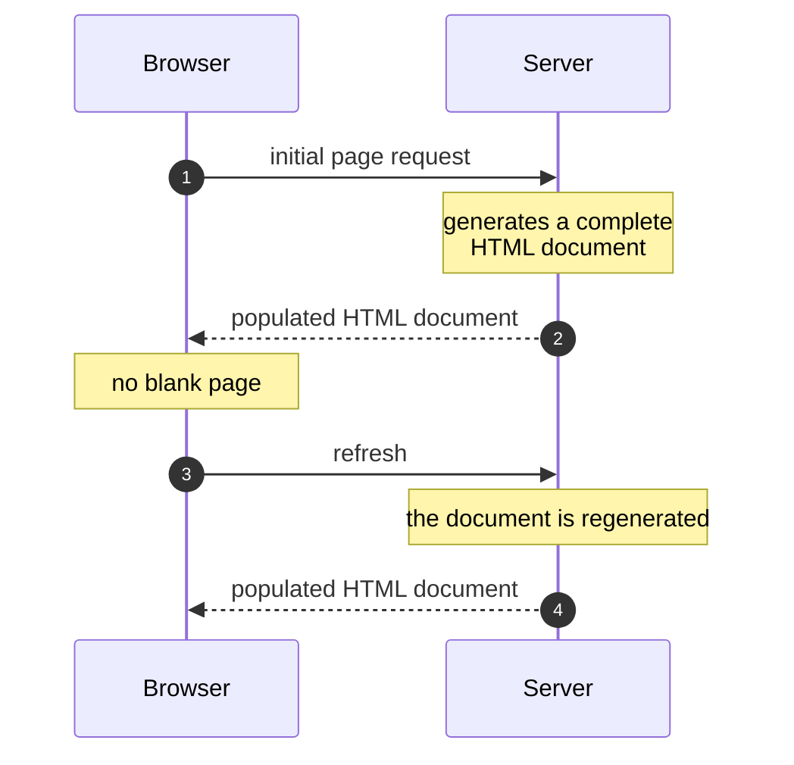
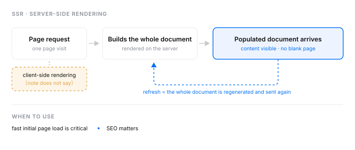

# Product architecture III

Two rendering approaches: **server-side rendering** and **client-side rendering**.

> 〔原文未说明〕 Client-side rendering is named but not described in this summary. Only
> server-side rendering is covered below.

## Server-side rendering

SSR generates a complete HTML document on the server and sends it to the client.

**Pro** — loading is fast, and the user doesn't see a blank page, because the server sends the browser an HTML document that is already populated.

**Con** — when the webpage is refreshed, the document is regenerated to render the component and sent to the client again.

**When to use it** — when a fast initial page load is critical, and when SEO matters.

The same section as one figure — the path, what it buys, and what it costs on every refresh:

---

## What changed

**补成句 — 原文 5 个残句 / 补了 5 个,0 个故意保留。**

| 原文 | 补成句 |
| ---- | ------ |
| `* server-side rendering` `* client side rendering` | `Two rendering approaches: server-side rendering and client-side rendering.` |
| `ssr = generates a complete html document on the server and sends it to the client` | `SSR generates a complete HTML document on the server and sends it to the client.` |
| `pro = fast loading, user dont see blank page because...` | `loading is fast, and the user doesn't see a blank page, because...` |
| `cons = refresh webpage the document is regenarated to render component and sent to the client` | `when the webpage is refreshed, the document is regenerated to render the component and sent to the client again` |
| `when to used ? fast initial page load is critical, SEO matters` | `when a fast initial page load is critical, and when SEO matters` |

**错字 / 术语** — `docuemnt` → `document` · `regenarated` → `regenerated` · `dont` → `don't` · `client side` → `client-side` · `html` → `HTML` · `when to used ?` → `When to use it` · `pro`/`cons` → `Pro`/`Con`(单数,因为各只有一条)

**补全 — 请核对(1 处)** — con 那句结尾补了 `again`。原文说刷新后文档「is regenarated ... and sent to the client」,没写「又一次」,但整句的要点就是重复这件事。不同意就删掉这个词。

**未补的** — 〔原文未说明〕**客户端渲染完全没有内容**。摘要把它列为两个主题之一,然后一个字也没写:没有定义、没有优缺点、没有适用场景。我没有替它补,正文只保留列名并在开头标注。这也是本篇只有一张图的原因(见下)。

**图 — 2 张,各管一件事。**

画的是 SSR,判据是「顺序」:初次加载和刷新走的是同一条链路,而**服务端完整生成这一步会重来一遍** —— 这是原文 con 那句的要点,时间轴比散文更能让人看见它重复了。图里每个词(complete HTML document / populated / blank page / refresh / regenerated)都在原文出现过。

第二张是 `023.svg`(手写 SVG,`/figure` 的 apply 模式),放在小节末尾做收束。它跟时序图不重复:时序图画的是**时间轴上的顺序**,这张画的是**结构** —— 刷新那条虚线回到「建整份文档」那一步,而 CSR 作为一个琥珀色的缺口挂在请求分叉处。加了一句图前引语("The same section as one figure…"),这句是我写的,不要可以删。

**没画 SSR vs CSR 的对比图**,尽管这是本篇最自然的一张图。因为对比需要 CSR 那一边的内容,而摘要里没有。凭已知的 CSR 常识补出另一半、画成一张看起来很完整的对照图,正是这个 skill 明令禁止的事 —— 你回头会以为那半边是自己理解的。CSR 补上之后,这张图值得画。
