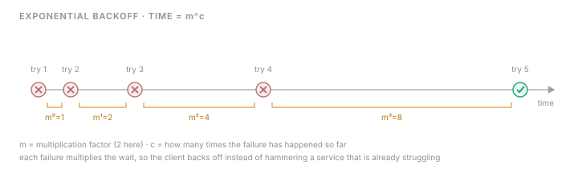
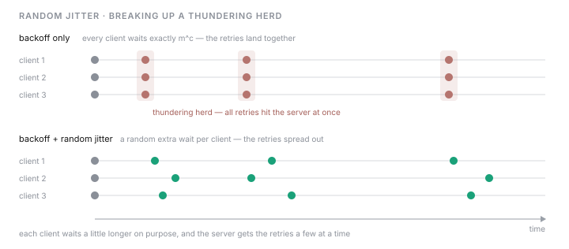
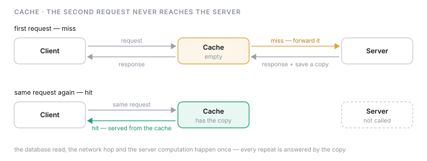
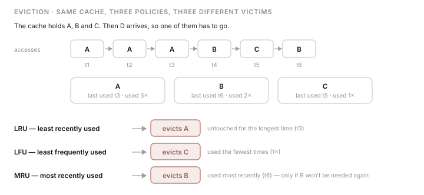
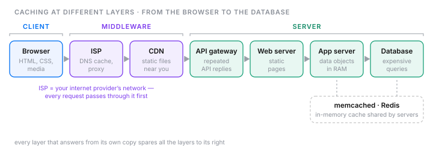
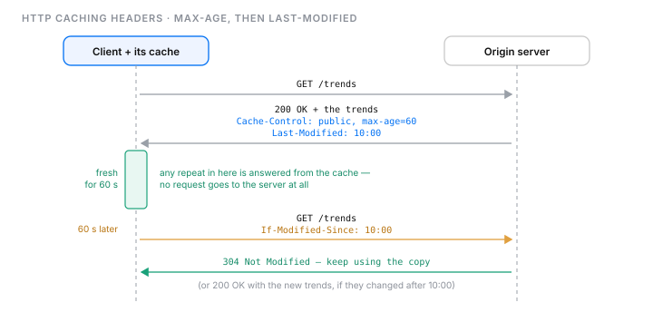
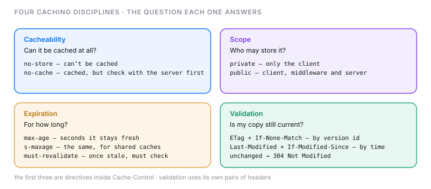

# Product architecture IV

## Managing retries

When a request fails to complete the request–response cycle, a retry comes in handy.

### Common errors

- **request lost** — the request hasn't reached the target service
- **response lost** — the server's response never reaches the client
- **service unresponsive** — the service cannot process the request because of a downstream error, and replies with an error message
- **response with error code** — the request was bad or had invalid parameters

### Why retries lead to issues

- retries lead to unnecessary use of computational resources
- numerous clients may retry simultaneously
- useless retries on a bad request waste bandwidth and overburden the server

### How to handle retries

- the **backoff algorithm** waits longer after every failed attempt: `time = m^c`, where `m` is the multiplication factor and `c` is how many times the failure has happened so far

- **random jitter** is not a separate kind of backoff — it is a random amount added on top of the backoff wait, so that clients stop retrying in lockstep (the thundering herd problem)

### HTTP codes that should not be retried as-is

Rule of thumb: a 4xx means the client has to fix something, a 5xx means the service has to act — retrying the unchanged request gets the same answer.

| 4xx | Meaning | 5xx | Meaning |
| --- | ------- | --- | ------- |
| 400 | bad request — breaks the rules | 501 | server doesn't support the functionality |
| 401 | invalid authentication credentials | 505 | HTTP version not supported |
| 403 | refuses to authorize the request | 507 | insufficient storage |
| 404 | requested resource doesn't exist | 508 | infinite loop detected |

## Caching

While retries address transient failures, repeated successful requests can also create unnecessary load.

A cache is simply temporary storage for frequently reused API responses:

1. the client sends the request
2. if the cache lacks the requested object, the request is forwarded to the back-end server
3. the server responds and saves a copy in the cache for subsequent requests

### Keeping the cache consistent with the server

A cache is a copy of the source of truth, so it can go stale. LRU, LFU and MRU are **eviction policies** — they decide which entry to throw out when the cache is full. They help freshness only indirectly; expiration and validation (the HTTP caching headers below) are what actually check a copy against the server.

| Policy | Evicts | Makes sense when |
| ------ | ------ | ---------------- |
| LRU — least recently used | the entry untouched for the longest time | what was used recently is likely to be used again |
| LFU — least frequently used | the entry used the fewest times | some entries stay popular over a long time |
| MRU — most recently used | the entry used most recently | an entry is known not to be needed again once used |

### Caching at different layers

- **client** — the web browser
- **middleware** — the ISP, DNS, and CDNs
- **server** — the API gateway, web server, application server, and database
- distributed cache solutions such as **memcached** and **Redis** are popular on the server side

What the unfamiliar terms mean:

- **ISP (Internet Service Provider)** — the company whose network connects you to the internet, such as a home broadband or mobile carrier. Every request passes through its network first, so it can keep a DNS cache and a caching proxy server in between.

| Server-side layer | Its job | What it caches |
| ----------------- | ------- | -------------- |
| API gateway | the front door that receives API calls and routes them | whole responses to repeated identical API calls, usually GET |
| Web server | serves the website | static pages; dynamic requests go on to the application server |
| Application server | runs the business logic | data objects in RAM, to skip slow disk reads |
| Database | stores the data | results of expensive, frequent queries |

- **memcached and Redis** — in-memory key-value stores that many application servers share, so something cached by one server is available to all of them. Memcached keeps plain values; Redis adds data structures such as lists, sets and hashes, and can persist data to disk.

## HTTP caching headers

- the server says how a response may be cached through headers such as **Cache-Control** — with directives like `max-age` — and **Last-Modified**
- the headers cover four disciplines: **cacheability, scope, expiration, and validation**

## API monitoring

API monitoring analyzes an API's overall performance to catch problems before developers and users run into them. It is more than an analysis tool: a remote monitor keeps sending HTTP requests to the API endpoints, and the monitoring tool checks the responses against metrics — response time, expected data, and correctness — and reports whatever falls outside the expected range.

The terms that come up in its key benefits:

- **RPM (requests per minute)** — how many requests the API handles in a minute; a low RPM is a cue to look at CPU and RAM
- **SLO (service level objective)** — the target you set yourself, e.g. 95% of API calls under 500 ms
- **SLA (service level agreement)** — the promise made to a customer, with consequences if it is missed; monitoring also checks that a third-party API meets its SLA

SLIs, SLOs and SLAs are also covered in note 02.

### Monitoring methods

- **synthetic API monitoring** — scripts simulate end-user paths and execute from different geographic locations, and the logs are monitored from there
- **RUM (real user monitoring)** — monitors real users' activity from their own devices, but requires more resources

### Key API metrics

| Metric | What it tells you |
| ------ | ----------------- |
| RPM | how many requests the API can handle per minute |
| Latency | how long data takes to travel from source to destination |
| Availability | how much of the time the server is up |
| TTFHW (time to first hello world) | how long until the first successful data exchange with the API |
| Failure rate (errors per minute) | how often calls fail |
| CPU and memory usage | which resource is about to become the bottleneck |

---

## What changed

### 第一轮 · 重试 / 缓存 / HTTP 缓存头 / API 监控(本次)

**来源** — 你写的摘要润色而来,**但以下几块是 Claude 代写的**,因为你说不熟、让我帮你消化:淘汰策略那一段和 LRU/LFU/MRU 表格、ISP 的解释、API gateway / web server / application server / database 的对比表、memcached 与 Redis、API monitoring 的定义展开、RPM/SLO/SLA 的解释、关键指标表的描述列。这几块不是你的理解,读完哪里不认同就改。

**补成句 — 原文 22 个残句 / 补了 19 个,3 个故意保留。** 另有 6 句结构本来完整(retries leads unnecessary utilization… · useless retries with bad request… · there is several http code… · while retries addres… · client send the request… · the server responds and saves…),只修拼写。

| 原文 | 补成句 |
| ---- | ------ |
| `managing retries: when fail to complete request response cycle, retry comes in handy` | When a request fails to complete the request–response cycle, a retry comes in handy. |
| `request lost: havent reach the target service` | the request hasn't reached the target service |
| `response lost: server response never reach the client` | the server's response never reaches the client |
| `service unresponsive: cannot process the request due to downstream error and with error message` | the service cannot process the request because of a downstream error, and replies with an error message |
| `response with error code: bad request or invalid params` | the request was bad or had invalid parameters |
| `numerous clients retyring simultaneiusly` | numerous clients may retry simultaneously |
| `backoffalgorithm` | the backoff algorithm waits longer after every failed attempt: time = m^c …(公式来自课程) |
| `different kind of backoff like random jitter` | random jitter is not a separate kind of backoff — it is a random amount added on top of the backoff wait …(见纠正 2) |
| `cache simply a temporary storage for frequently usable API` | A cache is simply temporary storage for frequently reused API responses |
| `lru` | LRU 那一行定义(Claude 写的) |
| `lfu` | LFU 那一行定义(Claude 写的) |
| `mru` | MRU 那一行定义(Claude 写的) |
| `client, middleware, server` | 拆成下面三条分层清单 |
| `distributed cache solutions memcached, redis` | distributed cache solutions such as memcached and Redis are popular on the server side |
| `cahce cotorl, max age, last modified` | the server says how a response may be cached through headers such as Cache-Control — with directives like max-age — and Last-Modified(见纠正 3) |
| `four disciplines: cacheability, scopem, exipiration, validation` | the headers cover four disciplines: cacheability, scope, expiration, and validation |
| `is simply a tool to analyze based on the metrics(response time, expected data, and correctness)?` | API monitoring 那一段定义(见纠正 4) |
| `there are synthetic api monitoring - using scripts that sumulate end user paths, excute from different geographics and monitoring the logs fro there` | scripts simulate end-user paths and execute from different geographic locations, and the logs are monitored from there |
| `rum: read user monitorigin from user device but required more resources` | RUM (real user monitoring) — monitors real users' activity from their own devices, but requires more resources(见纠正 1) |

**故意保留为片段(3 个)** — `client: web browser` · `middleware: ISP, dns, cdns` · `server: api gateway, web server , application server, database`:这是「层 → 有哪些」的对照清单,补成句只会变啰嗦。

**错字 / 术语** — `resourcesa` → `resources` · `retyring` → `retrying` · `simultaneiusly` → `simultaneously` · `backoffalgorithm` → `backoff algorithm` · `addres` → `address` · `repreated` → `repeated` · `levees` → `levels` · `cahce cotorl` → `Cache-Control` · `scopem` → `scope` · `exipiration` → `expiration` · `sumulate` → `simulate` · `excute` → `execute` · `fro` → `from` · `monitorigin` → `monitoring` · `rmb` → 不进正文 · `lru/lfu/mru/rum/rpm` → 大写

**纠正(你让我指出错的)**
1. **RUM** —— 原文写成「read user monitoring」,是 **real** user monitoring。
2. **random jitter** —— 原文「different kind of backoff like random jitter」。jitter 不是另一种 backoff,是**加在** backoff 算出来的等待时间上的随机值,目的是让大量客户端不在同一时刻重试(thundering herd)。
3. **max-age** —— 原文把 `cache control, max age, last modified` 并列成三个 header。`max-age` 是 `Cache-Control` 里的一个指令,不是单独的 header。
4. **API monitoring** —— 你问「是不是就是一个按指标分析的工具」。大体对,但它是整个过程:远程监控器**主动**持续向各个 endpoint 发 HTTP 请求,分析工具只是其中按指标检查响应、出报告的那一环。

**课程自己的问题**
- **LRU / LFU / MRU 被说成保持一致性的手段** —— 你的标题「how to handle consistency between cache and server」照着课程写的,不算你的错。但它们是**淘汰策略**,管的是「满了扔哪个」;真正让缓存和服务器对得上的是过期和校验(`max-age`、`ETag`、`Last-Modified`)。正文和图 `044` 按淘汰策略写。
- **`s-max-age`** —— 课程表格里这么拼,实际指令是 `s-maxage`。图 `047` 用的是正确拼法。

**补全 — 请核对(来自课程,你没写)**
- backoff 公式 `time = m^c`
- 不可重试状态码的含义,以及「4xx 要客户端改、5xx 要服务端处理」这条口诀
- jitter 那句里的「thundering herd」这个名字
- memcached / Redis「popular on the server side」
- 图 `047` 的内容基本就是课程那张四类表格(你说「用图帮我记」)

**未补的(课程里有、你没记,不算错)** — 没写进正文,要的话你补一句我再润色:
- **值得重试的**状态码:408、429、500、502、503、504 —— 你记的是不该重试的那一半
- 前两种错误(request lost / response lost)客户端**分不清**是哪种;第四种必须**先改请求**再重试
- 重试过多也伤客户端:免费 API 会被限流,付费 API 浪费调用额度
- 限制最大重试次数;服务端可以用 `Retry-After` header 告诉客户端等多久(适用于 429、503)
- synthetic 和 RUM 最好两个都用;synthetic 的结果可能和真实环境有差距

**图 — 7 张手写 SVG(`/figure` apply 模式)+ 1 张表**
- `041` exponential backoff —— 时间轴:每次失败后等待翻倍,间隔的长度就是公式
- `042` random jitter —— 时间轴对比:只有 backoff 时三个客户端的重试叠在同一时刻;加 jitter 后错开
- `043` cache miss → hit —— 两趟请求:第二趟停在缓存,服务器没被调用
- `044` 淘汰策略 —— 同一个缓存、同一串访问记录,LRU / LFU / MRU 各扔掉一个不同的条目(示例是 Claude 构造的)
- `045` 缓存分层 —— 从浏览器到数据库的整条路径,每个节点标它缓存什么;顺带回答 ISP 在哪、gateway/web/app server 差在哪
- `046` 缓存头时间线 —— `max-age` 期间直接用缓存,过期后带 `If-Modified-Since` 去问,拿到 `304`
- `047` 四类缓存策略 —— 每类回答的问题 + 对应的指令 / header
- 关键 API 指标 —— 你说图或表都行,这是并列清单,表格最合适,没画图

**没画的** — synthetic vs RUM(两条对照,正文已经说清)· 值得重试 vs 不该重试的状态码对照(你没记前一半)。
