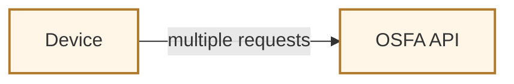
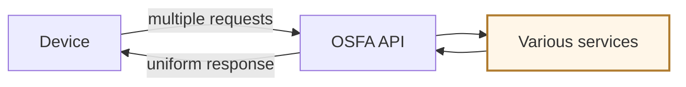
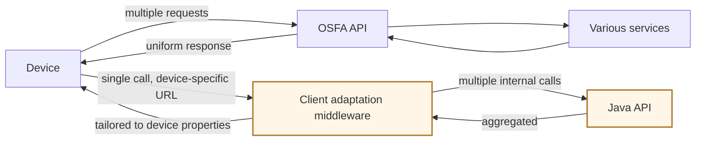

# Important concepts in product architecture

- API versioning
- evolution strategies
- rate limiting
- client-adaptive response

## Versioning principles

- backward compatible
- low frequency of updates
- should not break client applications

## When do we need versioning?

- altering the structure of the output, for example from string to JSON
- renaming the entities, `userId` to `userCredentials`
- breaking an API into microservices

## Versioning approaches

There are 3 popular approaches:

| Approach | How the version is carried |
| -------- | -------------------------- |
| URL versioning | the version sits in the path, `/v1`, `/v2` |
| HTTP header versioning | the version is negotiated through the HTTP `Accept` header |
| Hostname versioning | each version gets a new hostname |

## Evolving an API design

Three ways:

- change the interaction model itself — Twitter moved from clients constantly polling the Twitter API for new tweets, to a streaming API that uses persistent connections and lets developers subscribe to keywords
- provide options to filter results, such as date, order, and options to return specific fields (Slack RTM API)
- support bulk endpoints — for instance Slack lets you invite multiple users in one call

## Rate limiting

Rate limiting enforces a cap on the number of requests or the data volume a client can consume per unit of time. Rather than disconnecting clients, the rate limiter throttles excess requests by discarding them. It is considered a security layer against bots and DoS attacks.

| Strategy | What it does |
| -------- | ------------ |
| Consumption quota | defines the maximum number of API calls a client can make within a time frame |
| Spike arrest | detects and blocks an unexpected surge |
| Usage throttling | slows excessive calls from a specific user |
| Traffic prioritization | for example premium and free users get different usage quotas |

### How a rate limiter works

When it receives a request, the rate limiter looks up the client information, checks it against the maximum, then adds to the count.

### Where to place a rate limiter

| Placement | Consequence |
| --------- | ----------- |
| Client | vulnerable |
| Server | the same server handles both the API logic and the rate limiting |
| Middleware | isolated from frontend and backend, keeping rate-limiting concerns decoupled |

### Characteristics of rate limiting

- appropriate HTTP status code: for example `429` when a request is throttled, together with a `Retry-After` header
- custom response headers: `X-RateLimit-Limit`, `X-RateLimit-Reset`
- rate-limit status API: gives the client a way to query the limit status of a certain API

### Rate-limiting best practices

- different algorithms: token bucket, leaky bucket, fixed window, sliding window
- threshold selection
- exponential backoff: progressively increase the wait time between retries

## Server-side flexibility

- **intermediate adaptation code (IAC)** — see the Netflix example below
- **expanded fields** — for example `/finder/location` provides only the location details, but `/finder/location?expand=images` also provides the images inside those details
- **GraphQL** simply enables a single request that fetches diverse 〔原文未说明: diverse what〕 in one round trip

### The Netflix example, step by step

**① A device opens the Netflix main page, which triggers multiple requests to the OSFA API.**

**② The OSFA API retrieves data from various services, formats it, and delivers one uniform response — the same shape for every device.**

**③ With IAC, a client adaptation middleware takes one call to a device-specific URL, determines the client type, expands it into multiple internal calls to the Java API, aggregates the responses, and tailors the output to the device's properties before returning it.**

---

## What changed

**Typos / terminology** — `form` → `from` · `diconnecting` → `disconnecting` · `calles` → `calls` · `priorization` → `prioritization` · `approtate` → `appropriate` · `rete-limit` → `rate-limit` · `srtatus` → `status` · `limitting` / `limittinga` → `limiting` · `progressivel` → `progressively` · `flexbility` → `flexibility` · `exmaple` → `example` · `graphQL` → `GraphQL` · `usercredentials` → `userCredentials` (matched to the camelCase of `userId` in the same line) · `SLACK` → `Slack` (the same line already wrote it as `Slack`)

**Completed into sentences** — the rate-limiter and placement bullets were fragments; supplied subject and verb using the original's own words, no rewording. Three lists that were parallel one-line definitions (versioning approaches, rate-limiting strategies, placements) became tables; the wording inside them is unchanged.

**Reference cleared up** — "this provide the images" → "it also provides the images", where *it* is the `?expand=images` call.

**Completed from context — please check** — "server: same server handles both api logic" named only one of the two things `both` promises; written as "both the API logic and the rate limiting". If that is not what you meant, reject it.

**Not completed** — 〔原文未说明〕 "GraphQL … fetches diverse" has no object in the summary; *diverse what* is left marked rather than guessed. 〔原文未说明〕 how IAC *determines the client type* — the summary says it determines it, not from what.

**Diagrams** — 1 storyboard, 3 panels (the Netflix IAC example). It qualifies on two counts: hierarchy (a middleware sits between the device and the Java API) and concurrency (one call fans out into multiple internal calls, then aggregates). The panel count is 3 because the summary supplies exactly 3 slides — no fourth was invented. Panel ③ keeps the OSFA path visible so the contrast is the change between panels.

Nothing else was drawn. The versioning approaches, rate-limiting strategies, placements, characteristics and best practices are all one-line definitions or comparisons — a table says it, a diagram would not add anything. "How a rate limiter works" is a sequence, but the summary gives it in a single sentence; a 4-node flowchart would only restate that sentence.
